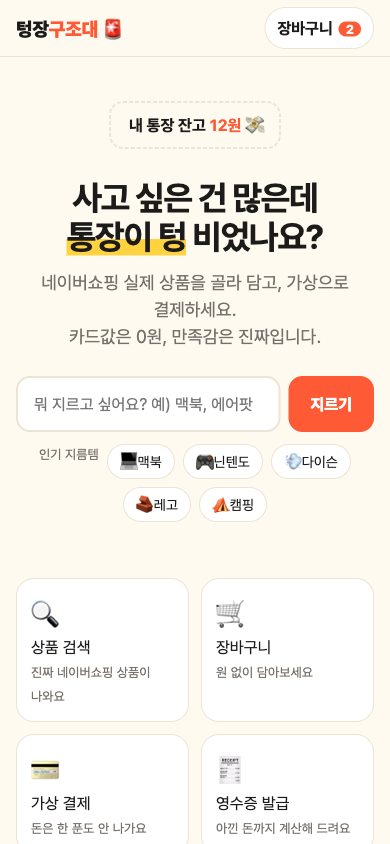
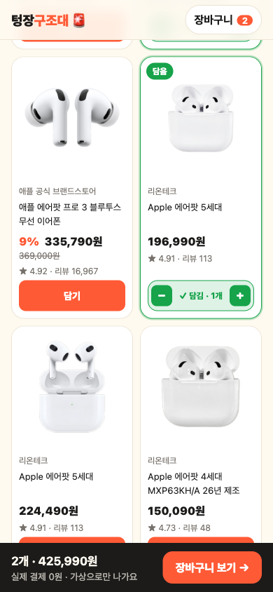

# 텅장구조대 🚨

> 사고 싶은 건 많은데 통장이 텅 비었나요? 네이버쇼핑 실제 상품을 골라 담고, **가상으로 결제**해서 대리만족하세요. 카드값은 0원, 만족감은 진짜입니다.

실제 결제는 일어나지 않는 체험 서비스입니다. 상품 정보는 네이버쇼핑 기준이며, 구매는 연결되지 않습니다.

## 화면

**랜딩 → 상품 검색 → 장바구니 → 결제 → 영수증** 순서로 이어집니다.

| 1. 랜딩 | 2. 상품 검색 |
|---|---|
|  |  |

| 3. 담으면 카드에 표시 + 하단 장바구니 바 | 4. 장바구니 |
|---|---|
|  |  |

| 5. 가상 결제 | 6. 결제 진행 중 |
|---|---|
|  |  |

| 7. 영수증 |
|---|
|  |

모바일도 지원합니다.

| 모바일 랜딩 | 모바일 검색 |
|---|---|
|  |  |

## 사용법

### 서비스 이용 흐름

1. **랜딩**에서 검색창에 사고 싶은 것을 입력하거나 인기 지름템 칩을 누릅니다.
2. **검색**에서 정렬(추천순, 구매 많은순, 리뷰 많은순, 낮은 가격, 높은 가격)을 고르고 **담기**를 누릅니다. 담은 상품은 초록 테두리와 `✓ 담김 · N개`로 바뀌고, 그 자리에서 수량을 늘리거나 뺄 수 있습니다. 화면 아래에는 담은 개수와 합계가 뜹니다.
3. **장바구니**에서 수량을 고치거나 삭제합니다.
4. **결제**에서 영수증에 찍힐 이름과 가상 결제 수단(상상카드, 허공페이, 무통장 상상입금)을 고르고 결제합니다. 카드 번호 등 결제 정보는 받지 않습니다.
5. **영수증**에서 주문 내역과 "지켜낸 내 돈"을 확인하고, 공유하거나 인쇄(PDF 저장)할 수 있습니다.

장바구니와 주문 내역은 브라우저 `localStorage`에 저장됩니다. 서버에는 아무것도 저장하지 않습니다.

### 로컬에서 실행하기

Node.js 18 이상이 필요합니다. 설치할 패키지는 없습니다.

```bash
# 1. Apify 토큰 설정 (없으면 샘플 데이터로 동작)
cp .env.example .env.local
#    .env.local 을 열어 APIFY_TOKEN= 뒤에 키를 붙여 넣습니다.

# 2. 개발 서버 실행
node server.js
#    → http://localhost:3000
```

- 서버를 켜면 터미널에 모드가 표시됩니다. `(Apify 실연동)`이면 실제 네이버쇼핑 상품이, `(목 데이터 모드)`이면 `data/sample.json`의 샘플 10개가 나옵니다.
- `.env.local`을 고친 뒤에는 서버를 껐다가 다시 켜야 반영됩니다.
- Apify 토큰은 [Apify 콘솔](https://console.apify.com/) > Settings > API & Integrations에서 발급합니다. 토큰은 서버(`api/search.js`)에서만 쓰이고 브라우저로 나가지 않습니다.

### 샘플 데이터 모드

토큰이 없거나 Apify 호출이 실패하면 샘플 상품으로 대신 답합니다. 검색 화면에 "샘플 상품 N개 (Apify 토큰 미설정 - 데모 데이터)"라고 표시됩니다.

## 구조

프레임워크 없이 HTML과 바닐라 JavaScript로 만들었습니다.

```
index.html            랜딩
search.html           상품 검색
cart.html             장바구니
checkout.html         가상 결제
receipt.html          영수증
assets/app.js         공용 코드 (장바구니, 포맷, 헤더, 토스트)
assets/style.css      공용 스타일 (다크 모드 대응)
api/search.js         검색 API (Apify 호출, 캐시, 샘플 대체)
data/sample.json      토큰이 없을 때 쓰는 샘플 상품
server.js             로컬 개발 서버
vercel.json           Vercel 함수 설정 (검색 API 최대 60초)
docs/screenshots/     README 캡처 이미지
```

### 검색 API

```
GET /api/search?q=<검색어>&sort=<REL|PURCHASE|REVIEW|LOW_PRICE|HIGH_PRICE>
```

```json
{ "source": "apify", "items": [
  { "id": "...", "name": "...", "image": "...", "price": 199000, "listPrice": 199000,
    "discount": 0, "mall": "...", "rating": 4.9, "reviews": 1509, "url": "..." }
] }
```

- 데이터는 Apify의 [Naver Shopping Scraper](https://console.apify.com/actors/g0DIy7jhI0dLfdKoo/info/readme) 액터(`g0DIy7jhI0dLfdKoo`)에서 가져옵니다. 검색 한 번에 상품 20개를 요청합니다.
- 같은 검색어와 정렬은 10분 동안 서버 메모리에 캐시합니다.
- `source`가 `mock`이면 샘플 데이터입니다.

## 배포 (Vercel)

HTML은 정적 파일로, `api/search.js`는 서버리스 함수로 동작합니다. 프로젝트 환경 변수에 `APIFY_TOKEN`을 등록해야 실제 상품이 나옵니다.

## 주의할 점

- **비용:** 검색 한 번에 약 $0.018(상품 20개, 1,000개당 $0.90 기준)이 듭니다. 공개 배포할 때는 호출 횟수 제한이 필요합니다. 지금은 같은 검색어 10분 캐시만 있습니다.
- **검색이 느릴 수 있습니다.** Apify 액터를 실행하는 시간이 들어서 실측으로는 5초 안팎이었고, 액터가 새로 시작될 때는 더 걸릴 수 있습니다. 같은 검색어를 다시 검색하면 캐시에서 바로 나옵니다.
- `.env.local`은 `.gitignore`에 들어 있어 커밋되지 않습니다. 토큰을 코드나 문서에 적지 마세요.

## 팀

허들링 클럽 9조
