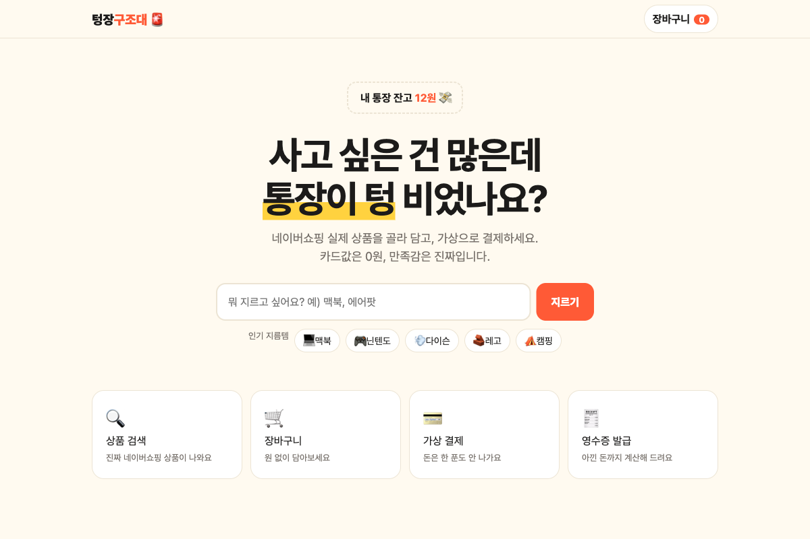
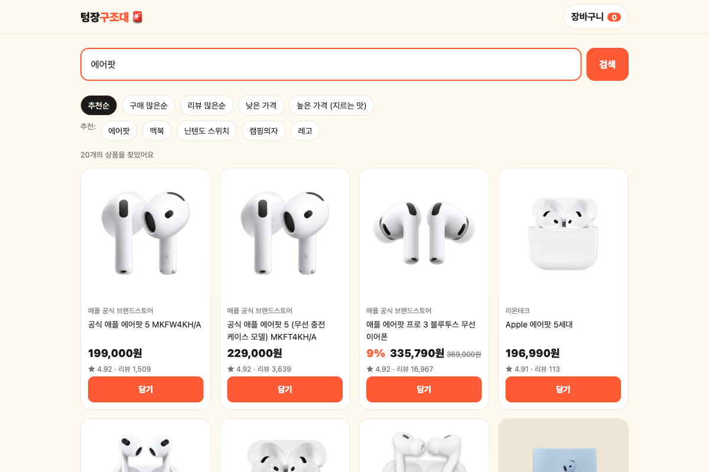
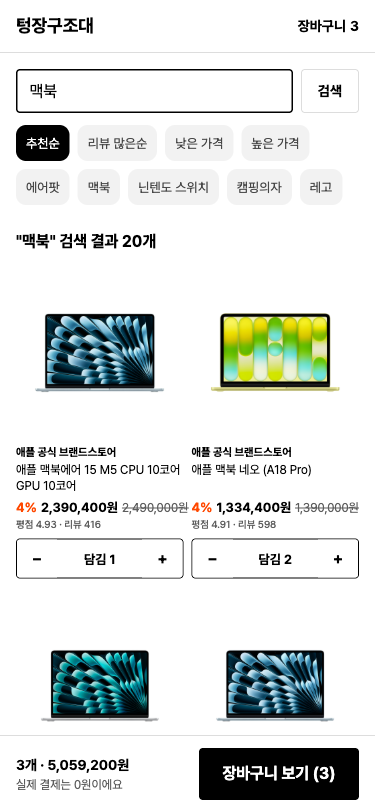
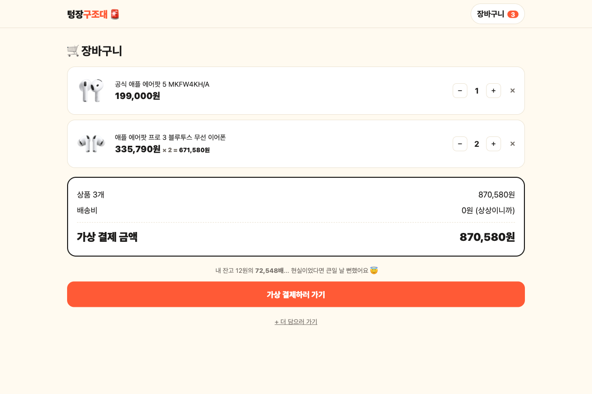
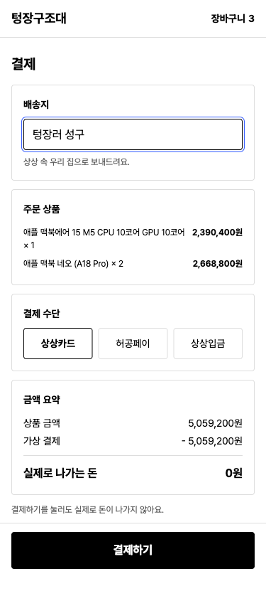
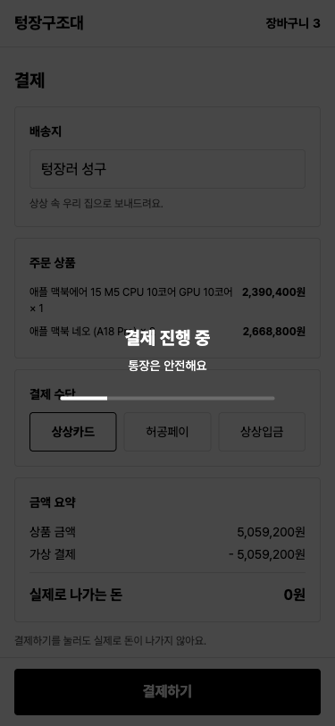
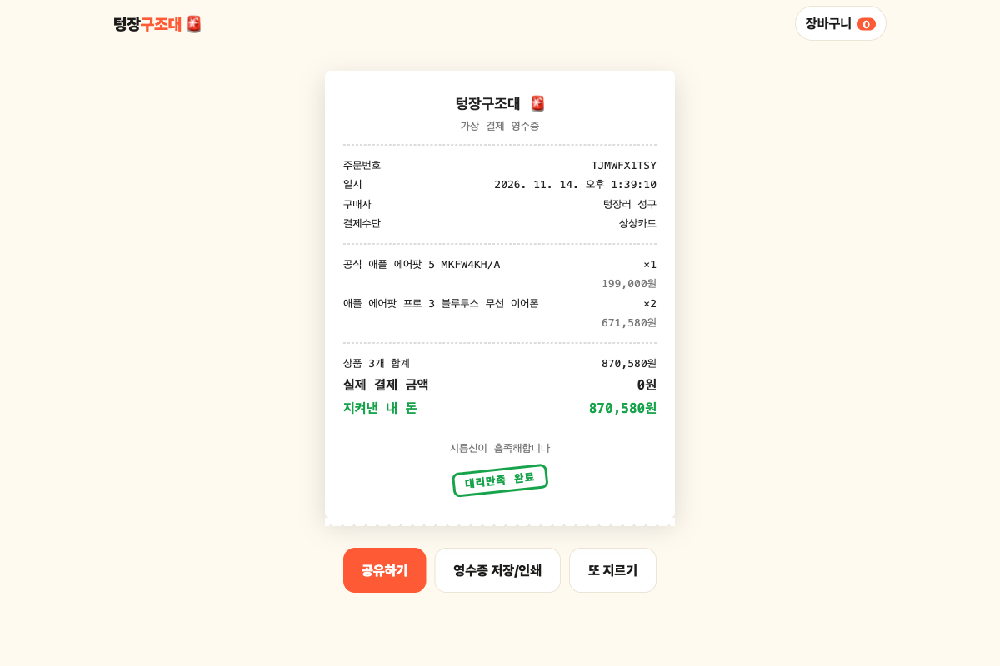

# 텅장구조대

> 사고 싶은 건 많은데 통장이 텅 비었나요? 네이버쇼핑 실제 상품을 골라 담고, **가상으로 결제**해서 대리만족하세요. 카드값은 0원, 만족감은 진짜입니다.

실제 결제는 일어나지 않는 체험 서비스입니다. 상품 정보는 네이버쇼핑 기준이며, 구매는 연결되지 않습니다.

디자인은 [DESIGN.md](DESIGN.md)의 토큰과 규격을 따릅니다. 기준 폭은 375px(모바일)이고, 화면은 모두 이 폭에서 찍었습니다.

## 화면

**랜딩 → 상품 검색 → 장바구니 → 결제 → 구조 보고서(영수증)** 순서로 이어집니다.

| 1. 랜딩 | 2. 상품 검색 | 3. 담은 상태 |
|---|---|---|
|  |  |  |

| 4. 장바구니 | 5. 가상 결제 | 6. 결제 진행 중 |
|---|---|---|
|  |  |  |

| 7. 구조 보고서 |
|---|
|  |

## 사용법

### 서비스 이용 흐름

1. **랜딩**에서 `쇼핑 시작하기`를 누릅니다.
2. **검색**에서 사고 싶은 것을 검색하고, 정렬(추천순, 리뷰 많은순, 낮은 가격, 높은 가격)을 고른 뒤 **담기**를 누릅니다. 정렬은 서버를 다시 부르지 않고 가져온 상품 안에서 화면이 다시 늘어놓습니다. 담은 상품은 `− 1 +`처럼 수량 조절로 바뀌어 그 자리에서 수량을 늘리거나 뺄 수 있고, 화면 아래에 담은 개수와 합계가 뜹니다.
3. **장바구니**에서 수량을 고치거나 `삭제`합니다. 담은 게 없으면 `주문하기`가 비활성입니다.
4. **결제**에서 받는 분 이름(영수증에 찍힙니다)과 가상 결제 수단(상상카드, 허공페이, 상상입금)을 고르고 `결제하기`를 누릅니다. 카드 번호 등 결제 정보는 받지 않습니다.
5. **구조 보고서**에서 주문 내역과 "지켜낸 내 돈"을 확인합니다. `영수증 저장`은 인쇄 창을 열어 PDF로 저장할 수 있고, `처음으로`는 랜딩으로 돌아갑니다.

장바구니와 주문 내역은 브라우저 `localStorage`에 저장됩니다. 서버에는 아무것도 저장하지 않습니다.

### 로컬에서 실행하기

Node.js 18 이상이 필요합니다. 설치할 패키지는 없습니다.

```bash
# 1. Apify 토큰 설정 (없으면 샘플 데이터로 동작)
cp .env.example .env.local
#    .env.local 을 열어 APIFY_TOKEN= 뒤에 키를 붙여 넣습니다.

# 2. 개발 서버 실행
node server.js
#    → http://localhost:3000
```

- 서버를 켜면 터미널에 모드가 표시됩니다. `(Apify 실연동)`이면 실제 네이버쇼핑 상품이, `(목 데이터 모드)`이면 `data/sample.json`의 샘플 10개가 나옵니다.
- `.env.local`을 고친 뒤에는 서버를 껐다가 다시 켜야 반영됩니다.
- Apify 토큰은 [Apify 콘솔](https://console.apify.com/) > Settings > API & Integrations에서 발급합니다. 토큰은 서버(`api/search.js`)에서만 쓰이고 브라우저로 나가지 않습니다.

### 샘플 데이터 모드

토큰이 없거나 Apify 호출이 실패하면 샘플 상품으로 대신 답합니다. 검색 화면에 "샘플 상품 N개 (Apify 토큰 미설정 - 데모 데이터)"라고 표시됩니다.

## 구조

프레임워크 없이 HTML과 바닐라 JavaScript로 만들었습니다.

```
DESIGN.md             디자인 기준 (토큰, 컴포넌트 규격, 화면별 기준)
index.html            랜딩
search.html           상품 검색
cart.html             장바구니
checkout.html         가상 결제
receipt.html          구조 보고서(영수증)
assets/app.js         공용 코드 (장바구니, 포맷, 헤더, 토스트)
assets/style.css      공용 스타일 (DESIGN.md 토큰)
api/search.js         검색 API (Apify 호출, 캐시, 샘플 대체)
data/sample.json      토큰이 없을 때 쓰는 샘플 상품
server.js             로컬 개발 서버
vercel.json           Vercel 함수 설정 (검색 API 최대 60초)
docs/screenshots/     README 캡처 이미지
```

### 검색 API

```
GET /api/search?q=<검색어>
```

```json
{ "source": "apify", "items": [
  { "id": "...", "name": "...", "image": "...", "price": 199000, "listPrice": 199000,
    "discount": 0, "mall": "...", "rating": 4.9, "reviews": 1509, "url": "..." }
] }
```

- 데이터는 Apify의 [Naver Shopping Scraper](https://console.apify.com/actors/g0DIy7jhI0dLfdKoo/info/readme) 액터(`g0DIy7jhI0dLfdKoo`)에서 가져옵니다. 검색 한 번에 상품 20개를 요청합니다.
- `source`가 `mock`이면 샘플 데이터입니다.
- 응답 헤더 `X-Cache`로 어떻게 답했는지 알 수 있습니다: `MISS`(Apify 호출), `HIT`(캐시), `DEDUPED`(같은 검색어의 동시 요청에 합류), `FAIL`(최근 실패한 검색어라 호출 생략), `MOCK`(토큰 없음).

### 호출 줄이기 (비용 방어)

Apify는 호출할 때마다 돈이 들어서 아래 순서로 막습니다.

| 단계 | 하는 일 |
| --- | --- |
| 브라우저 | 검색 결과를 `sessionStorage`에 30분 저장합니다. 새로고침, 뒤로 가기, 같은 검색어 재검색은 서버를 부르지 않습니다. 정렬 칩도 서버를 부르지 않습니다. 검색 중에는 버튼이 잠기고 앞선 요청은 취소됩니다. |
| CDN | 실제 Apify 결과에만 `s-maxage=3600`을 붙여 Vercel 엣지가 1시간 들고 있게 합니다. |
| 서버 캐시 | 검색어의 공백과 대소문자를 정리해 같은 키로 보고, 60분 동안 최대 300개를 메모리에 둡니다. |
| 동시 요청 합치기 | 같은 검색어가 동시에 오면 Apify는 한 번만 부릅니다. |
| 실패 기억 | 실패한 검색어는 30초 동안 다시 부르지 않고 샘플로 답합니다. |
| 호출 한도 | IP당 10분에 8번, 하루 전체 300번을 넘으면 429로 거절합니다. 캐시에 있는 검색어는 한도에 세지 않습니다. |

한도와 캐시 시간은 환경 변수로 바꿉니다(`.env.example` 참고): `SEARCH_CACHE_MIN`, `SEARCH_LIMIT`, `SEARCH_IP_MAX`, `APIFY_DAILY_LIMIT`.

서버리스는 인스턴스마다 메모리가 따로라 서버 캐시와 한도는 최선 노력입니다. 인스턴스가 여러 개 뜨면 합쳐서 한도보다 더 불릴 수 있어서, 확실한 상한이 필요하면 Apify 콘솔의 월 사용 한도를 함께 설정하세요.

## 배포 (Vercel)

HTML은 정적 파일로, `api/search.js`는 서버리스 함수로 동작합니다. 프로젝트 환경 변수에 `APIFY_TOKEN`을 등록해야 실제 상품이 나옵니다.

## 주의할 점

- **비용:** 새 검색어 한 번에 약 $0.018(상품 20개, 1,000개당 $0.90 기준)이 듭니다. 캐시와 호출 한도로 줄였지만(위 "호출 줄이기"), 공개 배포하기 전에 Apify 콘솔에서 월 사용 한도도 걸어 두세요.
- **가격·리뷰 정렬은 가져온 상품 20개 안에서만 정렬됩니다.** 네이버 전체에서 가장 싼 상품을 찾는 것이 아니라, 추천순 상위 20개를 다시 늘어놓은 것입니다. 구매 많은순은 구매 수 데이터가 없어 뺐습니다.
- **검색이 느릴 수 있습니다.** Apify 액터를 실행하는 시간이 들어서 실측으로는 5초 안팎이었고, 액터가 새로 시작될 때는 더 걸릴 수 있습니다. 같은 검색어를 다시 검색하면 캐시에서 바로 나옵니다.
- `.env.local`은 `.gitignore`에 들어 있어 커밋되지 않습니다. 토큰을 코드나 문서에 적지 마세요.

## 팀

허들링 클럽 9조
